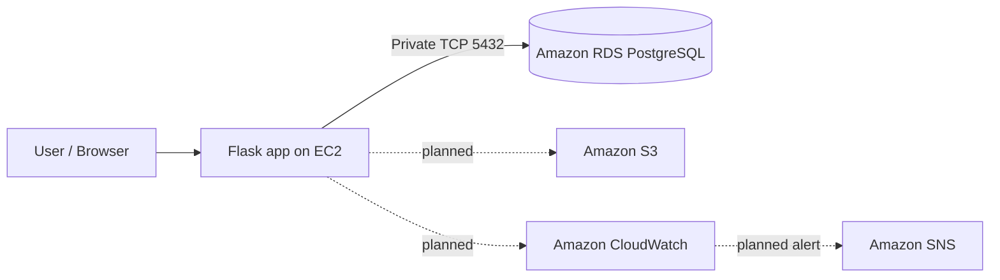

# AWS Cloud Support Portal

[](https://github.com/santhoshb22/aws-cloud-support-portal/actions/workflows/tests.yml)

A hands-on cloud support portfolio project focused on practical AWS infrastructure, application health checks, troubleshooting, and secure connectivity.

**Status:** Learning project in progress. This repository documents verified work separately from planned enhancements.

## Project goals

- Host a small Flask support portal.
- Practice EC2 administration on Amazon Linux 2023.
- Connect an EC2 instance to a private Amazon RDS for PostgreSQL database.
- Apply IAM roles instead of hard-coded AWS credentials.
- Build a foundation for S3 operations, CloudWatch monitoring, and SNS notifications.
- Document repeatable troubleshooting steps useful for Cloud Support / L1 Infrastructure roles.

## Architecture



The VPC design uses a `10.0.0.0/16` network with public and private subnets across two Availability Zones. The RDS database is intended to remain private and accept PostgreSQL traffic only from the EC2 security group. No database endpoint, account ID, IP address, or credentials are published here.

## Verified milestones

- [x] Flask application routes planned around `/`, `/health`, and `/ops`.
- [x] Amazon Linux 2023 EC2 instance prepared for database connectivity testing.
- [x] PostgreSQL 15 client installed and verified (`psql --version` returned 15.19).
- [x] TCP connectivity from EC2 to the RDS endpoint on port 5432 succeeded.
- [x] EC2 and RDS were stopped after the connectivity test to avoid unnecessary runtime costs.

## In progress / not claimed as complete

- [ ] Validate application-to-database authentication and execute a real query.
- [ ] Confirm the app is deployed and reachable end-to-end.
- [ ] Complete and test S3 integration.
- [ ] Configure and verify CloudWatch metrics/logs/alarms.
- [ ] Configure and test SNS notifications.
- [ ] Add sanitized screenshots and deployment evidence.

A successful TCP test proves network reachability only; it does **not** prove that PostgreSQL authentication or SQL queries work.

## Repository layout

```text
.
├── app.py
├── requirements.txt
├── Dockerfile
├── deploy-ec2.sh
├── .env.example
├── .gitignore
└── docs/
    ├── architecture.md
    ├── deployment.md
    └── troubleshooting.md
```

## Run locally

Requires Python 3.10+.

```bash
python -m venv .venv
# Linux/macOS
source .venv/bin/activate
# Windows PowerShell: .venv\Scripts\Activate.ps1
pip install -r requirements.txt
cp .env.example .env
python app.py
```

Open `http://127.0.0.1:5000`. The default local mode does not require AWS credentials or make AWS changes.

- `GET /` — portal landing page
- `GET /health` — application health and configured integration status
- `GET /ops` — basic operational summary (does not expose secrets)

Set `APP_ENV=aws` only when you intentionally want to use the AWS SDK integration. Use an attached IAM role in AWS; do not put access keys in source code.

## Deploying on AWS

See [docs/deployment.md](docs/deployment.md). Review the commands and resource settings before running them. AWS services may incur charges; this project follows a **$0-extra-cost-first** approach. Keep EC2 and RDS stopped when not working, and check billing before enabling paid networking or monitoring features.

## Screenshots and evidence

The [`screenshots/`](screenshots/) folder is reserved for real, sanitized evidence captured after each feature is verified. See its README for the evidence checklist and redaction rules. No screenshot should imply an untested feature is complete.

## Security

- Never commit `.env`, credentials, private keys, database passwords, real endpoints, account IDs, or unredacted screenshots.
- Prefer an EC2 instance profile / IAM role over long-lived access keys.
- Keep RDS private; allow inbound PostgreSQL only from the application security group.
- Do not expose operational endpoints publicly without authentication and network restrictions.
- Review AWS billing and resource state after each lab session.

## Automated checks

A GitHub Actions workflow compiles the Python source and runs basic route tests on pushes and pull requests. The workflow result is shown in the badge above.

## Project completion standard

This repository will remain marked **in progress** until the advertised functionality has been implemented and verified end to end. The final README and resume description will be updated only after the relevant tests pass and evidence is captured. A network-level TCP success is not the same as a successful database login or SQL query.

## Skills demonstrated

AWS fundamentals · EC2 · VPC and subnets · Security Groups · IAM roles · Amazon RDS for PostgreSQL · Linux administration · TCP troubleshooting · Flask · environment-based configuration · technical documentation

## Author

**Santhosh Balachandran** — Cloud Support / Infrastructure learning portfolio.

This project is for learning and demonstration. Verify every resource and integration in your own AWS account before describing it as production-ready.
